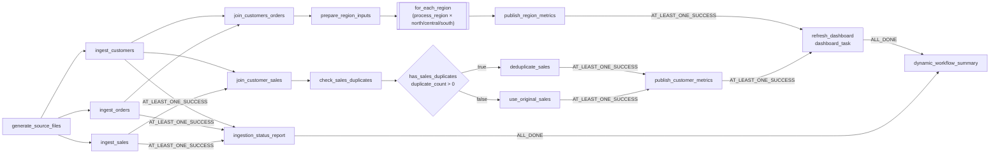

# retail-dynamic-workflow

A standalone Databricks Asset Bundle that deploys one Lakeflow Job, **`retail-dynamic-workflow-job`**, to demonstrate dynamic workflow features on serverless compute. It is compatible with **Databricks Free Edition**.

| Feature | Where |
|---|---|
| Concurrent ingestion (customers, orders, sales) | `ingest_*` tasks all depend only on `generate_source_files` |
| Run-if dependencies | `ingestion_status_report`, `publish_customer_metrics`, `refresh_dashboard` (`AT_LEAST_ONE_SUCCESS`) |
| If/Else condition | `has_sales_duplicates` → `deduplicate_sales` / `use_original_sales` |
| For Each | `for_each_region` → nested `process_region` for `north`, `central`, `south` |
| ALL_DONE audit | `dynamic_workflow_summary` |
| Dashboard refresh | `refresh_dashboard` (`dashboard_task`) refreshes the AI/BI dashboard |

The business logic lives in `src/retail_dynamic/`. Notebooks only read widgets, call functions, write outputs, and set task values.

---

## Project layout

```text
retail-dynamic-workflow/
├── databricks.yml                     # bundle, variables, dev/prod targets
├── pyproject.toml                     # ruff + pytest config, dev deps
├── resources/
│   ├── dynamic_retail_job.yml         # the Lakeflow Job
│   └── retail_dashboard.yml           # 5 UC schemas, raw Volume, AI/BI dashboard
├── src/
│   ├── notebooks/                     # 00 … 14, one per task
│   ├── dashboards/retail_dashboard.lvdash.json
│   └── retail_dynamic/
│       ├── config.py                  # job params -> JobConfig, table names
│       ├── generators.py              # deterministic synthetic data (pure Python)
│       ├── transforms.py              # Spark transforms + Delta writers
│       ├── quality.py                 # duplicate/orphan checks, audit log
│       └── task_values.py             # task value keys + helpers
└── tests/                             # pytest (local Spark + static bundle checks)
```

### Unity Catalog objects

| Schema | Content |
|---|---|
| `<schema_prefix>_raw` | Volume `source_files/` with `customers/customers.csv`, `orders/orders.json`, `sales/sales.csv` |
| `<schema_prefix>_bronze` | `customers`, `orders`, `sales` (+ `_source_file`, `_ingested_at`, `_run_id`) |
| `<schema_prefix>_silver` | `customer_orders`, `region_order_metrics` (partitioned by region), `customer_sales`, `clean_sales` |
| `<schema_prefix>_gold` | `region_metrics`, `customer_metrics`, `category_revenue`, view `latest_audit_status` |
| `<schema_prefix>_audit` | `task_audit_log`, `workflow_run_log` |

> In `dev` (development mode), the bundle may prefix schema names with `dev_<your_user>_`. The job receives the **resolved** schema names as job parameters (`${resources.schemas.*.name}`), so the notebooks and dashboard follow the prefix automatically.

---

## Setup

### 1. Install and authenticate the Databricks CLI

```bash
# Databricks CLI v0.250+ recommended (needs dashboard dataset_catalog/dataset_schema support)
databricks -v
databricks auth login --host https://<your-workspace>.cloud.databricks.com
databricks auth profiles          # DEFAULT should show Valid = YES
databricks current-user me
```

### 2. Variables

| Variable | Default | Notes |
|---|---|---|
| `catalog` | `workspace` | The Free Edition default catalog |
| `schema_prefix` | `retail_dyn` | Creates `retail_dyn_raw`, `_bronze`, `_silver`, `_gold`, `_audit` |
| `warehouse_id` | lookup `"Serverless Starter Warehouse"` | Used by the dashboard and `refresh_dashboard`. Change the lookup name in `databricks.yml` if your warehouse has a different name |
| `for_each_concurrency` | `2` | Parallel `process_region` iterations |
| `schedule_pause_status` | `PAUSED` | `UNPAUSED` turns on the 30-minute schedule |
| `record_scale` | `"1"` | Default for the job parameter (1 = 200 customers / 800 orders) |
| `inject_duplicates` | `"false"` | Default for the job parameter |

Override a variable per command:

```bash
databricks bundle deploy --var="schema_prefix=retail_demo" --var="for_each_concurrency=3"
```

### 3. Local development

```bash
python -m venv .venv && source .venv/Scripts/activate   # Git Bash on Windows (.venv/bin/activate on Linux/macOS)
pip install -e ".[dev]"                                  # pyspark needs Java 17 for the Spark tests
ruff check .
pytest
```

---

## Workflow DAG



Text version:

```text
generate_source_files
 ├─> ingest_customers ─┐
 ├─> ingest_orders  ───┼─(AT_LEAST_ONE_SUCCESS)─> ingestion_status_report ─────────────┐
 └─> ingest_sales  ────┘                                                               │
customers + orders -> join_customers_orders -> prepare_region_inputs                   │
     -> for_each_region [process_region(input)] -> publish_region_metrics ──┐          │
customers + sales  -> join_customer_sales -> check_sales_duplicates         │          │
     -> has_sales_duplicates (duplicate_count > 0)                          │          │
          true  -> deduplicate_sales  ─┐                                    │          │
          false -> use_original_sales ─┴(AT_LEAST_ONE_SUCCESS)─> publish_customer_metrics
                                                                            │          │
          publish_region_metrics + publish_customer_metrics                 │          │
            -(AT_LEAST_ONE_SUCCESS)-> refresh_dashboard ─(ALL_DONE)─> dynamic_workflow_summary
```

### Task dependencies and `run_if`

| Task | Depends on | `run_if` | Why |
|---|---|---|---|
| `ingest_customers/orders/sales` | `generate_source_files` | `ALL_SUCCESS` (default) | Same single parent, so all three start **concurrently** |
| `ingestion_status_report` | all three ingests | `AT_LEAST_ONE_SUCCESS` | Still reports when one ingest fails. A missing dataset is recorded as `MISSING` |
| `join_customers_orders` | `ingest_customers`, `ingest_orders` | `ALL_SUCCESS` | Needs both inputs |
| `for_each_region` | `prepare_region_inputs` | `ALL_SUCCESS` | Input array comes from task value `regions` |
| `publish_region_metrics` | `for_each_region` (the **container**) | `ALL_SUCCESS` | Waits for every iteration. Never depends on `process_region` directly |
| `has_sales_duplicates` | `check_sales_duplicates` | — | `condition_task`: `{{tasks.check_sales_duplicates.values.duplicate_count}} > 0` |
| `deduplicate_sales` | `has_sales_duplicates` with `outcome: "true"` | — | Runs only when duplicates exist |
| `use_original_sales` | `has_sales_duplicates` with `outcome: "false"` | — | Runs only when there are no duplicates |
| `publish_customer_metrics` | both branches | `AT_LEAST_ONE_SUCCESS` | Exactly one branch runs and the other is *excluded*, so `ALL_SUCCESS` would never run |
| `refresh_dashboard` | both publish tasks | `AT_LEAST_ONE_SUCCESS` | Refreshes even if only one side of the metrics was published |
| `dynamic_workflow_summary` | `refresh_dashboard`, `ingestion_status_report` | `ALL_DONE` | Always runs, even when upstream tasks failed or were skipped. It is the leaf task, so it **fails the run** if any expected check is missing or failed |

### Rerun and concurrency safety

- Source files are deleted and recreated on each run (`write_source_files`), and bronze/silver/gold tables use full-refresh `overwrite`, so reruns never append duplicates.
- `process_region` writes with `replaceWhere region = '<region>'` into a table **partitioned by region**. That table is created up front by `prepare_region_inputs`, so parallel iterations touch disjoint partitions and never overwrite each other. An empty region still writes a zero row.
- Audit rows are `MERGE`d on `(run_id, check_name)`, so a repair run updates rows instead of duplicating them. There is also a retry for Delta concurrent-write conflicts.
- Both If/Else branches write `silver.clean_sales` with the same columns (`CLEAN_SALES_COLUMNS`), plus `processing_branch` = `deduplicated` or `original`.
- `max_concurrent_runs: 1` and `queue.enabled: true` mean scheduled or manual runs queue instead of overlapping.

---

## Validate, deploy, run

```bash
databricks bundle validate                 # dev (default target)
databricks bundle validate -t prod

databricks bundle deploy                   # dev
databricks bundle deploy -t prod

databricks bundle run dynamic_retail_job   # resource key, not the display name
```

### Testing both If/Else branches

```bash
# FALSE branch: no duplicates -> use_original_sales runs, deduplicate_sales is excluded
databricks bundle run dynamic_retail_job --params inject_duplicates=false

# TRUE branch: ~2-5 % duplicate sales -> deduplicate_sales runs, use_original_sales is excluded
databricks bundle run dynamic_retail_job --params inject_duplicates=true

# Bigger data volume (record_scale 1..50)
databricks bundle run dynamic_retail_job --params inject_duplicates=true,record_scale=5
```

Check the result:

```sql
SELECT * FROM workspace.retail_dyn_audit.workflow_run_log ORDER BY recorded_at DESC;
SELECT * FROM workspace.retail_dyn_gold.latest_audit_status;
SELECT processing_branch, count(*) FROM workspace.retail_dyn_silver.clean_sales GROUP BY 1;
```

(In dev, use your prefixed schema names, for example `dev_<user>_retail_dyn_gold`.)

### Unpausing the 30-minute schedule

The schedule is `0 0/30 * * * ?` in `Asia/Ho_Chi_Minh` and is **PAUSED** by default.

```bash
# prod target: deploy with the schedule enabled
databricks bundle deploy -t prod --var="schedule_pause_status=UNPAUSED"

# pause it again
databricks bundle deploy -t prod --var="schedule_pause_status=PAUSED"
```

Development mode (`dev`) always deploys schedules paused. In dev, use `bundle run`, or unpause temporarily in the UI (**Jobs & Pipelines → job → Schedules & Triggers → Unpause**). The next `bundle deploy` pauses it again.

---

## Dashboard

`resources/retail_dashboard.yml` deploys **Retail Dynamic Workflow** from `src/dashboards/retail_dashboard.lvdash.json`. Its queries use unqualified table names, and the bundle sets `dataset_catalog` and `dataset_schema` to the gold schema. It shows:

- total revenue and revenue by region (`region_metrics`)
- revenue by category (`category_revenue`)
- top 10 customers (`customer_metrics`)
- latest audit status per check (`latest_audit_status` view over the audit log)

`refresh_dashboard` runs **before** `dynamic_workflow_summary`. So the `revenue_reconciliation` and `workflow_run` rows of the current run appear after the *next* refresh. All other checks are already current.

---

## Free Edition limitations and notes

- **Serverless only**: there are no `job_clusters`, `new_cluster` or `existing_cluster_id` settings. Notebook tasks run on serverless jobs compute.
- **Max 5 concurrent job tasks** per account. The defaults peak at about 3–4 running tasks. Keep `for_each_concurrency` ≤ 3. Extra tasks wait in the queue.
- **One small SQL warehouse** (Serverless Starter Warehouse) is used by the dashboard and the dashboard task.
- **Fair-usage quota**: a 30-minute schedule runs 48 times a day. Unpause it only while you need it.
- `databricks bundle destroy` removes the job, the dashboard, **and the schemas and volume (with data)**, because they are bundle-managed.
- Notebooks import the package with `sys.path.insert(0, "..")`. This relies on bundle-synced workspace files, where a notebook's CWD is its own folder.
